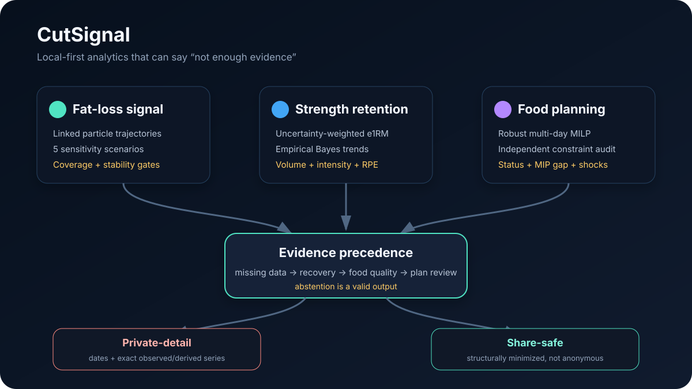
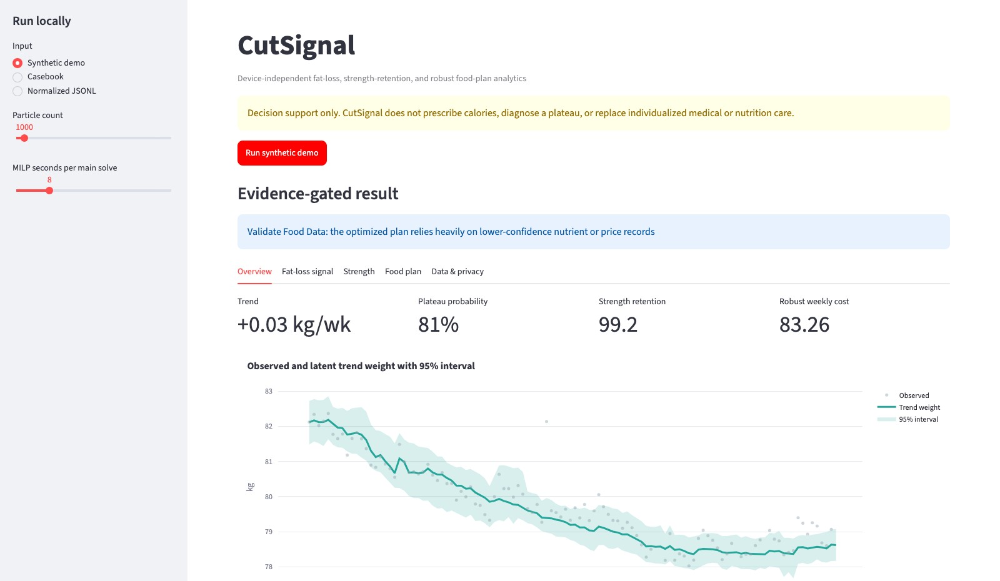
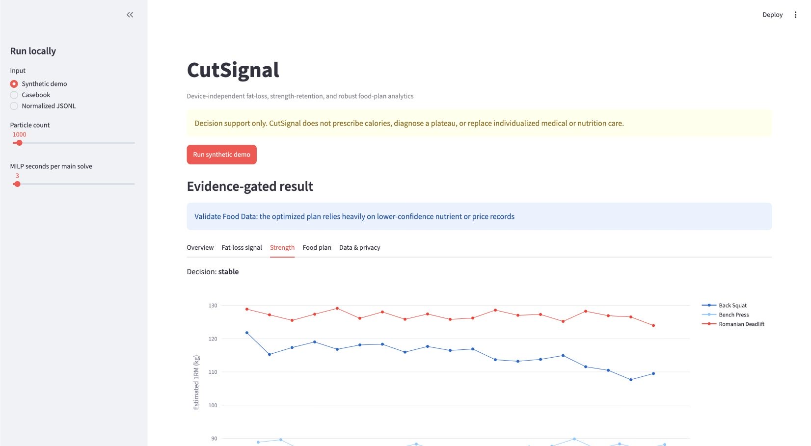
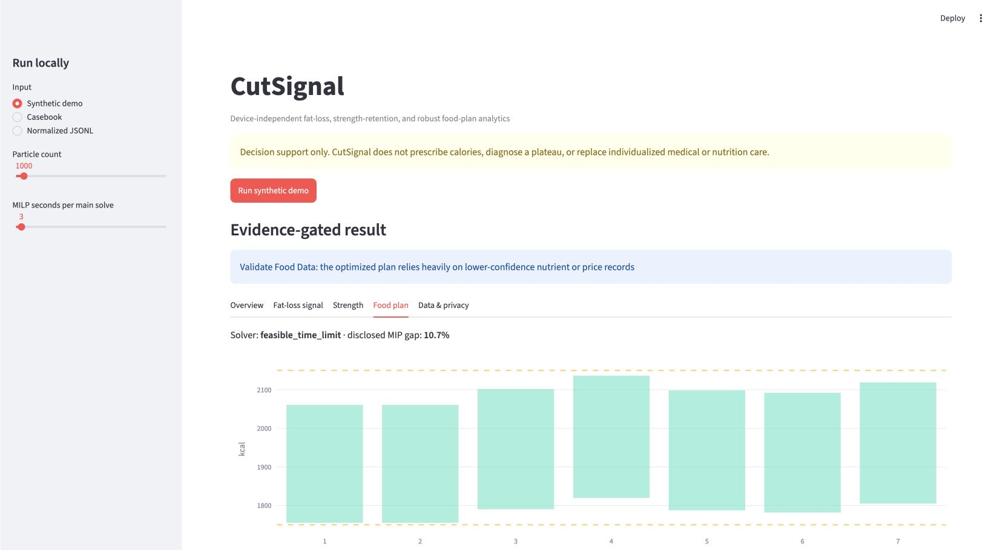
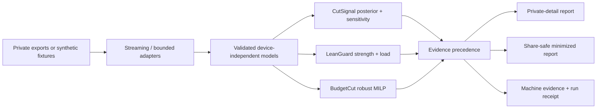

# CutSignal

**Local-first decision analytics for fat-loss trends, strength retention, and robust food planning.**

[](https://www.python.org/)
[](LICENSE)
[](CHANGELOG.md)
[](https://github.com/limingrui679-design/cutsignal/actions/workflows/ci.yml)
[](https://github.com/limingrui679-design/cutsignal/actions/workflows/security.yml)

CutSignal turns noisy weight, intake, training, and food data into an evidence-gated decision:
continue, collect more data, review recovery first, or consider reviewing the plan. It is
device-independent after normalization, runs locally, exposes uncertainty and solver gaps, and has
explicit reasons to abstain.

It does **not** diagnose a plateau, choose a calorie target, recommend rapid weight loss, identify
the cause of strength change, or replace a clinician or registered dietitian. No users, adoption,
external review, clinical validity, or real-world impact are claimed.

[中文说明](docs/README.zh-CN.md) · [Methods](docs/METHODS.md) ·
[Method references](docs/REFERENCES.md) ·
[Executable cases](docs/CASEBOOK.md) · [Privacy](docs/PRIVACY.md) ·
[Validation](docs/VALIDATION.md) · [Data card](docs/DATA_CARD.md) ·
[Tutorial](docs/TUTORIAL.md) · [Benchmarks](docs/BENCHMARKS.md) ·
[Troubleshooting](docs/TROUBLESHOOTING.md) · [Audit ledger](docs/PROJECT_AUDIT.md)



## What it decides

| Engine | Question | Method | When it stops |
|---|---|---|---|
| **CutSignal** | Is recent weight truly flat after fluid, scale, intake, and process uncertainty? | robust bootstrap particle filter, linked-trajectory rate posterior, BIC change points, five sensitivity scenarios | insufficient duration/coverage, wide TDEE interval, or unstable action |
| **LeanGuard** | Is performance being retained while body weight changes? | consensus e1RM, formula-uncertainty-weighted regression, empirical Bayes shrinkage, volume/intensity/RPE/frequency summaries | insufficient repeated sessions or conflicting decline/fatigue evidence |
| **BudgetCut** | Can user-supplied food constraints hold under nutrient and price uncertainty? | robust multi-day MILP, independent post-solve validation, stronger coefficient shocks | infeasible inputs or low food-data quality; a nonzero gap limits objective-optimality claims, not independently checked feasibility |

The three engines are integrated in a precedence rule: inadequate data first, recovery risk second,
food-data quality third, and only then a possible plan review. This prevents a scale-only signal from
silently overriding missing data or declining training performance.

## Run the fixed synthetic demo

CutSignal requires Python 3.11 or newer.

```bash
git clone https://github.com/limingrui679-design/cutsignal.git
cd cutsignal
python -m venv .venv
source .venv/bin/activate        # Windows: .venv\Scripts\activate
python -m pip install --upgrade pip
python -m pip install -e '.[ui]'

cutsignal doctor
cutsignal demo --output artifacts/demo
cutsignal ui
```

The generated input values are deterministic synthetic fixtures, not a real person or population
sample. A time-limited MILP can return different independently validated feasible incumbents across
runs or machines; its status and gap remain visible, and byte-identical reports are not promised.
The demo creates:

- normalized daily, strength, food, and constraint inputs;
- `report.html` and `report.json`, explicitly labeled **private-detail** outputs;
- `report.share-safe.html` and `report.share-safe.json`, structurally minimized outputs;
- `artifact_manifest.json` with paths, sizes, and SHA-256 hashes.

The private profile contains dates, observed weight/intake, latent TDEE, exercise metrics, and menu
details. The share-safe profile removes dates, daily series, exact health metrics, exercise/food
names, exact constraints, and menus. It still contains derived categories and does not guarantee
anonymity; inspect it before sharing.

### Visual tour

All screenshots below were rendered from the bundled fixed synthetic demo.



<details>
<summary>Strength and robust food-plan views</summary>





</details>

## Explore decision and failure modes

One happy-path demo is not enough. The executable casebook covers nine different gates:

```bash
cutsignal cases list
cutsignal cases run missing-intake-abstain
cutsignal cases run strength-fatigue-gate
cutsignal cases verify --output artifacts/cases.json
```

| Case | What it demonstrates |
|---|---|
| `plateau-sensitivity-gate` | an unstable plateau-looking signal is downgraded |
| `missing-intake-abstain` | missing paired intake prevents TDEE interpretation |
| `water-spike-resilience` | one injected scale spike does not reverse the fixture action |
| `strength-fatigue-gate` | decline plus volume/RPE evidence triggers recovery review |
| `stable-strength-cut` | multi-exercise retention with load/intensity/frequency summaries |
| `budget-shock` | modeled feasibility and visible failure under stronger shocks |
| `vegetarian-allergen-plan` | dietary tags, soy exclusion, nutrition, budget, time, and variety |
| `device-overlap-reconciliation` | phone/watch additive streams are not blindly summed |
| `generic-schema-migration` | external-shaped CSV aliases, units, duplicates, and provenance survive normalization |

Every case is labeled `deterministic_synthetic_fixture` and emits its assertions, observed values,
duration, and limitation. See [the casebook](docs/CASEBOOK.md) for the exact evidence boundary.

## Compare against a simple baseline

```bash
python scripts/evaluate_synthetic.py --output artifacts/synthetic-evaluation.json
```

This fixed known-truth stress grid compares the linked-particle recent-rate result with an
observed-weight OLS baseline under clean, high-fluid, missing-data, recent-outlier, and logged-intake
bias conditions. It reports error distributions, 95% interval coverage, Brier score, classification
errors, and per-scenario failures. It is internal synthetic evaluation—not external calibration,
population performance, or clinical validity. See [VALIDATION](docs/VALIDATION.md).

## Architecture



The analytical core never depends on Apple Watch or any single vendor. Adapters end at validated
domain models; analysis starts there. The run receipt records input counts, analysis configuration,
user-supplied constraints, solver limits, and the trade-off search method without embedding source
exports or identities.

## Supported inputs

### Daily health data

The normalized daily schema supports body weight, logged energy intake, active energy, steps, sleep,
training minutes, resting heart rate, and HRV.

```bash
cutsignal import apple-health ~/Downloads/export.zip data/private/daily.jsonl
cutsignal import daily-csv daily.csv data/private/daily.jsonl --provider garmin-export
```

Apple Health `.xml`/`.zip` is streamed without archive extraction. For additive source-day fields
such as steps, phone and watch totals are not blindly added: CutSignal keeps the largest source total
and emits a reconciliation flag. This is a visible heuristic, not a claim that the selected source is
always correct.

Generic aliases cover dates, kg/lb weight, intake, active energy, steps, sleep, training time,
resting HR, and HRV. CSV/JSONL readers enforce file, row, and line limits before or during parsing.

### Strength data

Hevy and Strong CSV exports are auto-detected. A generic file needs date, exercise, weight, and reps;
RPE, set type, body weight, and duration are optional.

```bash
cutsignal import strength hevy-export.csv data/private/strength.jsonl
```

Warm-ups and sets above the configured repetition ceiling are retained at import but excluded from
e1RM trends and counted in quality output.

### Food data

Validated JSONL is the lossless format; CSV supports pipe-delimited tags/allergens and JSON-encoded
micronutrient and source fields. Helper functions normalize USDA FoodData Central and Open Food
Facts responses. Local price, serving, uncertainty, preference, allergen, and availability
assumptions remain the user's responsibility.

API keys come from environment variables and are never added to result models or reports. Do not
commit `.env`.

## Methods in brief

### Trend weight and latent TDEE

For particle `i` on day `t`:

```text
TDEE[i,t]         = TDEE[i,t-1] + process noise
trend_weight[i,t] = trend_weight[i,t-1]
                    + (logged_intake[t] - TDEE[i,t]) / energy_density[i]
                    + process noise
fluid[i,t]        = phi * fluid[i,t-1] + process noise
scale_weight[t]   ~ StudentT(trend_weight[i,t] + fluid[i,t], measurement_scale)
```

Energy density is uncertain; missing intake widens the process; Student-t observations limit an
isolated scale excursion. Recent kg/week draws come from linked particle trajectories, preserving
represented temporal covariance through resampling. The default plateau band is visible and
configurable (±0.10 kg/week). A posterior probability is a model summary, not a diagnosis.

### Strength retention

LeanGuard uses the median of Epley, Brzycki, and Lombardi estimates and incorporates RPE-derived
repetitions in reserve when available. Formula disagreement becomes a heuristic measurement
variance in weighted regression. Eligible exercise slopes then receive empirical Bayes
random-effects shrinkage. The project does not describe this as a fully Bayesian hierarchy.

Outputs include absolute and allometric relative e1RM change, uncertainty interval, decline
probability, change points, training volume, mean intensity, RPE, frequency, fatigue agreement, and
an observed body-weight/strength non-dominated set.

### Robust food planning

BudgetCut chooses integer servings over 1–14 days. Hard constraints include calorie bounds,
protein, fiber, optional sodium/micronutrients, price, preparation time, repetition, variety,
allergens, and required/forbidden dietary tags.

Robust minimums use `value × (1 - uncertainty)`; robust maximums and prices use
`value × (1 + uncertainty)`. After HiGHS returns an incumbent, an independent validator rebuilds
every hard constraint from the selected menu. Additional nutrient and price shocks are reported
without re-optimization.

The public optimizer rejects catalogs above 500 candidate foods and per-solve limits above one
hour; filter a larger source catalog before optimization. These resource bounds prevent accidental
local exhaustion and do not imply that every 500-food mixed-integer model will solve quickly.

Five explicit weighted objectives produce a sampled non-dominated trade-off set. It is **not an exhaustive
Pareto frontier**: discrete non-convex or unsampled solutions can be missed. Solver status
and available MIP gap are always retained; a time-limited feasible incumbent is not called optimal.
The independently validated primary balanced plan is retained if an optional comparison profile
finds no incumbent; private output retains its label/type/reason and minimized output retains the
failed profile label.

Full assumptions and equations are in [docs/METHODS.md](docs/METHODS.md).

## Use your own normalized data

```bash
cutsignal analyze \
  --daily data/private/daily.jsonl \
  --strength data/private/strength.jsonl \
  --foods data/private/foods.jsonl \
  --constraints data/private/constraints.json \
  --output reports/private/run-001 \
  --report-profile private

# Create a structurally minimized bundle instead.
cutsignal analyze \
  --daily data/private/daily.jsonl \
  --strength data/private/strength.jsonl \
  --foods data/private/foods.jsonl \
  --constraints data/private/constraints.json \
  --output artifacts/share-review \
  --report-profile share-safe
```

Nothing is sent to a CutSignal service: the project has no telemetry, account, hosted database,
advertising SDK, or model API. A compromised computer, browser, shell history, or cloud-synced
folder remains outside this protection boundary.

## Reproduce and verify

For development, install the full test toolchain:

```bash
python -m pip install -e '.[dev]'
ruff check .
ruff format --check .
mypy src/cutsignal
pytest --cov=cutsignal --cov-branch --cov-report=term-missing
python scripts/verify_project.py
python scripts/score_project.py
```

The verifier creates machine-readable evidence for the exact checkout. Its gates include lint,
format, strict typing, tests and branch coverage, sdist/wheel builds, isolated temporary-venv wheel
installation, public-API import, packaged case resources, `pip check`, `pip-audit`, UI startup, nine executable
cases, the known-truth method benchmark, package/metadata/citation/changelog version consistency,
privacy/credential scan, source/method/claims-registry validation,
semantic documentation checks, and an end-to-end
synthetic run. Repository-local Markdown links and image assets are checked separately.
On a cold or slow machine, the full verifier can take 15–25 minutes because it creates a fresh
virtual environment and queries a vulnerability service. Each gate and fresh-install phase prints
bounded progress; a network timeout fails instead of reusing an older result.

Coverage evidence reports the combined metric and branch-only metric separately; the score requires
at least 90% combined coverage and 80% branch-only coverage.

`score_project.py` consumes that evidence only when its checkout fingerprint and the SHA-256/size of
every score-critical generated artifact still match. A full engineering score means the versioned
repository gates passed; it does **not** mean 100% model
accuracy, clinical approval, deployment readiness, fairness, adoption, or impact. CI results are not
claimed until a public remote actually runs them.

## Evidence and claim discipline

- `data/registry/claims.yml` binds each public capability statement to code/tests and lists what it
  does not establish.
- `data/registry/sources.yml` records source role, bundling status, license/terms, and caveats.
- `data/registry/method_references.yml` maps authoritative method sources to the exact mechanism
  borrowed and the validity that cannot be transferred from the citation.
- `docs/PROJECT_AUDIT.md` records P0/P1 findings and their machine gates.
- `artifacts/verification.json`, `artifacts/cases.json`, and `artifacts/score.json` are generated
  evidence and intentionally ignored by Git.
- Public fixtures are deterministic synthetic data. They are never described as real users.

## Current boundaries

CutSignal is an alpha research/engineering project. It still needs externally governed validation
for plateau calibration, device error and subgroup performance, controlled strength testing,
regional food prices/labels, and prospective user outcomes. Competition snapshots and convenient
wearable datasets are not treated as longitudinal fat-loss ground truth.

Read [LIMITATIONS](docs/LIMITATIONS.md) and [VALIDATION](docs/VALIDATION.md) before interpreting an
output or proposing deployment.

## Contributing and security

Synthetic minimal reproductions are welcome. Never attach a real health export to a public issue.
New adapters need contract fixtures, reconciliation rules, input bounds, source/license review, and
failure tests. See [CONTRIBUTING.md](CONTRIBUTING.md), [SECURITY.md](SECURITY.md), and the
[Code of Conduct](CODE_OF_CONDUCT.md).

Apple, Hevy, Strong, Garmin, Fitbit, COROS, USDA, Open Food Facts, and OpenPowerlifting do not
endorse or sponsor CutSignal.

## License

CutSignal code is MIT-licensed. Third-party datasets retain their own licenses and are not
redistributed unless the source registry explicitly permits it.
