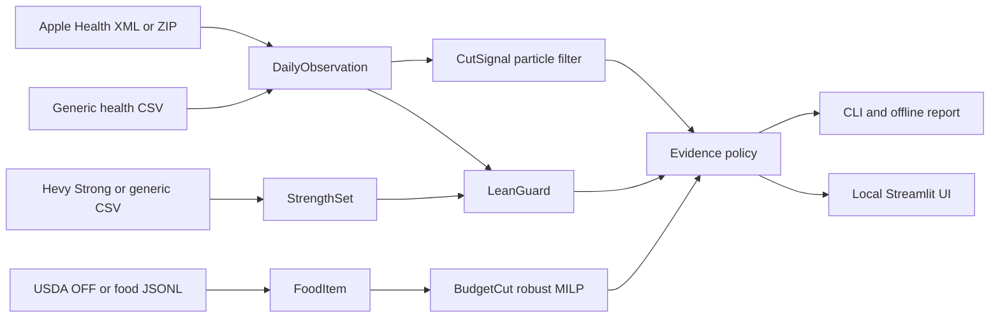

# Architecture

CutSignal separates ingestion, validated domain records, analytical engines, decision policy, and
presentation. The statistical code never depends on a specific wearable SDK.

## Module boundaries

- `importers/` converts external formats and attaches provenance. Adapters may reconcile duplicate
  devices, but they may not make health decisions.
- `models.py` is the contract between adapters and engines. Pydantic rejects impossible ranges and
  unknown fields.
- `analysis/state_space.py` owns latent weight/TDEE inference. `analysis/cut.py` owns sensitivity
  scenarios and evidence gates.
- `analysis/strength.py` owns e1RM, exercise-level shrinkage, fatigue, and the body-weight/strength
  frontier.
- `optimization/diet.py` owns eligibility filtering, robust constraints, solver status, stress
  tests, and objective profiles.
- `pipeline.py` is the only cross-engine policy layer. The ordering is explicit: insufficient data,
  then recovery risk, then food-data quality, then possible plan review.
- `reporting/` receives derived models only. It has no access to source export paths or credentials.

## Extension rule

A new wearable or app adapter is complete only when it:

1. maps units and dates into `DailyObservation` or `StrengthSet`;
2. attaches provider and record-type provenance;
3. documents whether duplicate values are summed, averaged, selected, or rejected;
4. adds fixture-based tests for missing values, duplicates, and unit conversion;
5. does not add a cloud dependency to the analytical core.

See [DEVICE_ADAPTERS.md](DEVICE_ADAPTERS.md) for the format contract.
